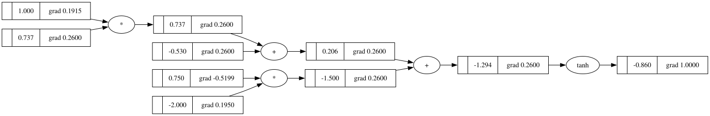

# micrograd

A tiny scalar-valued autograd engine and neural network library, built from scratch to learn how backpropagation works.
Mainly built as a learning exercise, mostly to see the whole machinery behind backpropagation but mostly to try to have a lower level understanding the whole training process.

An example of the dependency graph for a expression:


## Features

- `Value`: a scalar that records the operations applied to it and computes gradients with `backward()`
- Supported operations: `+`, `-`, `*`, `/`, `**`, `tanh`, `relu`, `exp`
- `nn`: `Neuron`, `Layer` and `MLP` modules
- `optimizer`: stochastic gradient descent (SGD)
- `losses`: sum of squared errors
- `utils`: draw the computation graph with Graphviz

## Installation

Requires Python 3.14+ and [uv](https://docs.astral.sh/uv/).

```sh
cd micrograd
uv sync
```

To draw graphs, you also need the Graphviz system package.

## Usage

### Automatic differentiation

```python
from micrograd.value import Value

a = Value(2.0, _label="a")
b = Value(-3.0, _label="b")
c = a * b + a
c.backward()

print(a.grad)  # dc/da = b + 1 = -2.0
print(b.grad)  # dc/db = a = 2.0
```

### Training a small network

```python
from micrograd.nn import MLP
from micrograd.optimizer import Optimizer
from micrograd.losses import MSE

xs = [[2.0, 3.0, -1.0], [3.0, -1.0, 0.5], [0.5, 1.0, 1.0], [1.0, 1.0, -1.0]]
ys = [1.0, -1.0, -1.0, 1.0]

model = MLP(3, [4, 4, 1])
optimizer = Optimizer(lr=0.05, parameters=model.parameters())

for step in range(100):
    preds = [model(x) for x in xs]
    loss = MSE(ys, preds)

    optimizer.zero_grad()
    loss.backward()
    optimizer.step()
```

The full script is in [`example.py`](example.py):

```sh
uv run python example.py
```

### Visualizing the graph

```python
from micrograd.utils import draw_graph

draw_graph(c).render("graph")  # writes graph.svg
```

## Project structure

```
src/micrograd/
├ value.py      # Value class and autograd
├ nn.py         # Neuron, Layer, MLP
├ optimizer.py  # SGD
├ losses.py     # loss functions
└ utils.py      # graph visualization
```

## Tests

```sh
uv run pytest
```

## Roadmap

- [x] Scalar autograd engine
- [x] MLP
- [x] SGD optimizer
- [ ] SGD with momentum
- [ ] Adam
- [ ] MSE
- [ ] More tests (compare gradients against PyTorch or finite differences)

impl this in rust?
